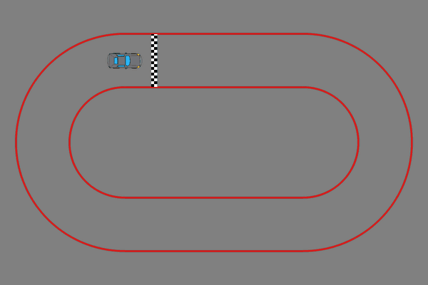
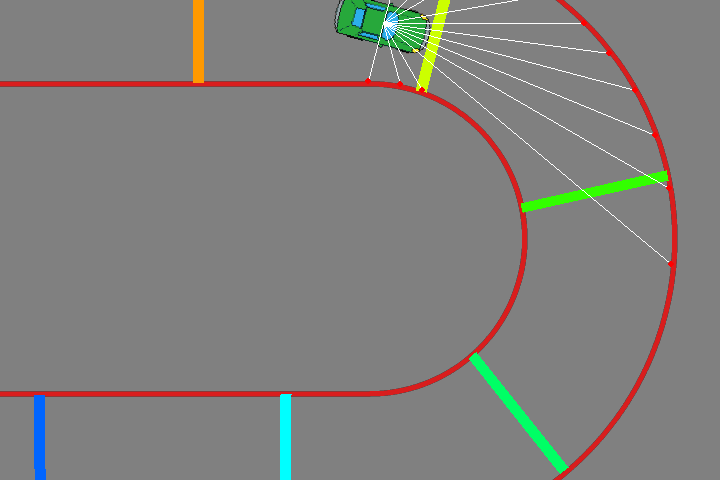
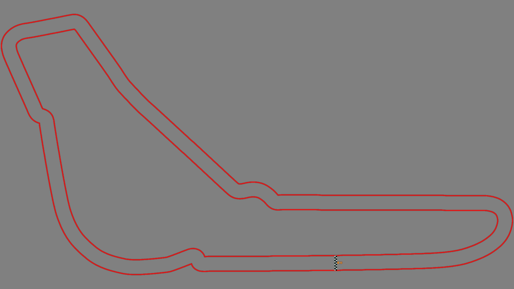

With this project I wanted to experiment with Reinforcement Learning and genetic algorithms.
I built a simple racing game using Pygame as the initial platform on which to train my models, set up a reward system for playing the game and then I wrote a simple fully connected model.
The model was trained first using a simplified genetic algorithm, based on the main reward system, and then tuned using reinforcement learning.
 

## Game

The game is a simple racing game in Pygame. The maps are hand-drawn PNGs, from which the game derives the wall mask at initialization. Every car spawns in the same starting position and must complete a full lap in the correct direction. 

Collisions with the walls result in a reset.

### Checkpoints

Checkpoints are invisible lines drawn on the map at regular intervals.
They provide rewards and determine the car's direction of travel. 
The finish line triggers the finish event only after the car visited all checkpoints in order, and going backwards to a previously visited checkpoint results in a negative reward.

### Driving dynamics

The game has four inputs: accelerate, brake, turn left and turn right. The inputs are used to modify the car's speed and angle and, at each tick, speed and angle determine the car's movements on the map.

The game is playable manually, using the arrow keys or by models that decide which action to perform out of all possible combinations.

### Sensors

Cars controlled by the model have a set of sensors: these sensors simply determine wether a possible collision is in their line of sight. 
The sensor output is an "intensity" that decreases linearly, from 1 to 0, with the distance up to a maximum distance, where it reaches 0.

The sensors are evaluated with a naive algorithm that simply checks all positions in a straight line at fixed angles from the car's center. I decided against optimizing to preserve the scope of the project.

## Training

During training multiple AI controlled cars are spawned on the track at the same time. They play the game for a set number of "steps". 
A step consists of:
1. Gather observations from the current state. Observations are simply the set of sensors' intensities and the current speed, normalized by the maximum speed.
2. Decide the next action
3. Perform the action and evaluate the new state for collisions and rewards.

### Genetic

### Reinforcement

